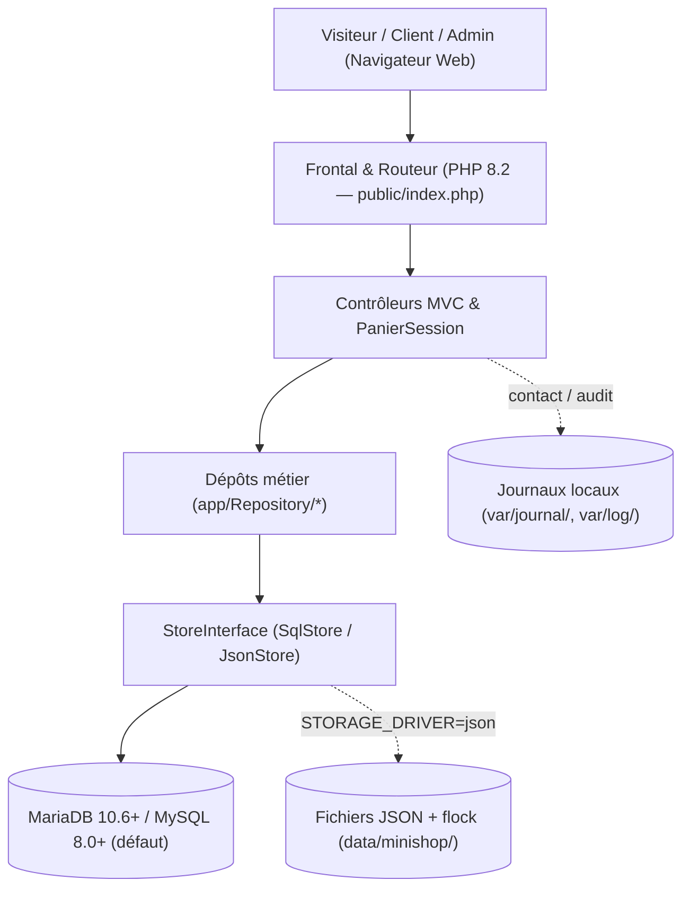

# Service Overview : MiniShop (Boutique & Back-office)

**Owner :** Équipe MiniShop (`Johan Polsinelli` & `Chahd Gouiaa`)  
**Criticité :** Tier 2 pédagogique — maquette e-commerce (non destinée à la production réelle)  
**SLA / Objectif de latence (`ENF-01`) :** `< 500 ms` par requête (`p95 = 6,0 ms` HTTP mesuré sur VM Debian 13) · **Dernière vérification :** 2026-11-16

---

## 1. Vue d’ensemble

**MiniShop** est une boutique en ligne pédagogique développée en PHP 8.2+ MVC. Elle permet aux visiteurs et clients de parcourir un catalogue informatique, gérer leur panier, créer un compte et passer ou annuler des commandes (paiements et livraisons simulés), et fournit aux administrateurs (`GESTIONNAIRE`, `SUPER`) un back-office complet de gestion du catalogue, des stocks et des commandes.

**Chiffres clés (dépôt vérifié) :**

- `9` tables normalisées 3FN, `4` vues SQL, `18` procédures stockées et `16` déclencheurs (`sql/01..04`)
- `15` contrôleurs PHP (`public/index.php`, `app/Router.php`), `113` fichiers PHP documentés (`394` méthodes publiques)
- Latence mesurée sur VM Debian 13 (`minishop_perf`) : **`p95 = 6,0 ms` HTTP** et **`p95 <= 20,6 ms` SQL** (`44 ms` sur `sp_create_order_from_basket`)

---

## 2. Architecture et dépendances

*(Diagrammes complets sur 4 niveaux dans `docs/diagrams/src/c4_*.puml` ; architecture détaillée dans `ARCHITECTURE.md`.)*

**Composants principaux :**

- **Frontal & Routeur :** `public/index.php`, `app/Router.php` (liste blanche HTTP + gardes `public`/`client`/`admin`/`super`)
- **Sécurité & Session :** `app/Security/{Auth,Csrf,xss}.php` (cookies `HttpOnly`/`SameSite=Lax`, CSRF `hash_equals`, CSP `'self'`)
- **Métier & Persistance :** `app/Repository/*`, `app/Model/PanierSession.php`, `app/Model/Data/{StoreInterface,SqlStore,JsonStore}`
- **Outils CLI d’exploitation :** `scripts/db_init.php` (`--nettoyage` RGPD, `RetentionComptes`, `NettoyageJournaux`, `libsodium`)

**Dépendances :**

| Dépendance | Catégorie | Rôle | Impact si indisponible | Timeout / Repli (Fallback) |
|---|---|---|---|---|
| **MariaDB (`minishop`)** | Infrastructure critique | Catalogue, clients, commandes (`sp_*`), triggers d’audit | **HTTP 500** sur toutes les routes SQL | Verrous `FOR UPDATE` en SQL ; bascule manuelle possible en démo/test via `STORAGE_DRIVER=json` |
| **Système de fichiers `var/`** | Infrastructure locale | Sessions PHP (`MINISHOPSESS`), `var/journal/db.jsonl`, `var/log/contact.jsonl`, `var/backups/` | Coupure de session si disque plein ; perte de trace si saturé | `Journal::create()` et `NettoyageJournaux::ajouter()` sont **non bloquants** (ne cassent pas le parcours boutique) |
| **Services externes (PSP / SMTP / CDN)** | Externe (aucun en V1) | Paiements, livraisons et contact sont simulés en local ; polices et CSS servis depuis `public/` | Aucun impact réseau (`ENF-20` hors ligne) | En cible V2 documentée (`docs/27`), prévoir PSP HMAC, OIDC `sso.minishop.fr` et Redis sessions |

---

## 3. Données et conformité RGPD

| Donnée | Sensibilité | Stockage | Rétention / Protection |
|---|---|---|---|
| **Compte client (`client`)** | PII (nom, prénom, email, adresse, téléphone) | MariaDB (`SqlStore`) ou `data/minishop/client.json` | Mot de passe haché `bcrypt` ; purge des comptes inactifs via `RetentionComptes` (`db_init.php --nettoyage`) |
| **Compte administrateur (`administrateur`)** | PII + rôle RBAC (`GESTIONNAIRE`/`SUPER`) | MariaDB / `administrateur.json` | Aucune route d’inscription admin ; création réservée au rôle `SUPER` |
| **Commandes & stocks (`commande`, `journal_stock`)** | Interne / audit comptable | MariaDB (`16` triggers d’audit) | Conservées même après purge client (`commande.id_client` nullable) |
| **Panier (`MINISHOPSESS`)** | Session locale | Session PHP serveur | Contient uniquement `{id_produit => quantite}` ; prix/totaux recalculés côté serveur |
| **Données de carte bancaire** | Critique (PCI-DSS) | **Jamais stockée** | Paiement simulé en maquette (`11/11` contrôles `tests/security/controles.sh`) |

---

## 4. Opérations essentielles

- **Lancement / déploiement local :** `cp .env.example .env && ./run.sh --db && ./run.sh` (ou `STORAGE_DRIVER=json` sans serveur SQL).
- **Supervision & journaux :** `var/journal/db.jsonl`, `var/log/contact.jsonl`, *Slow Query Log* MariaDB (`long_query_time = 0.05` en recette VM), `error_log` PHP.
- **Santé & validation rapide :** `php scripts/run-all-tests.php --sans-sql --sans-e2e`, `bash tests/security/controles.sh`, `python3 scripts/verifier_doc_code.py`.
- **Seuils d’alerte & ouverture de postmortem :** HTTP 500 récurrents, `p95 > 500 ms` (`ENF-01`), indisponibilité `> 15–30 min`, échec sauvegarde/restauration (`near miss`) → suivre `docs/exploitation/runbook-incidents.md` puis `guide-postmortem-blameless.md`.

---

## 5. Liens rapides

| Ressource | Emplacement dans le dépôt |
|---|---|
| **Code & architecture** | [`README.md`](../../README.md) · [`ARCHITECTURE.md`](../../ARCHITECTURE.md) · [`STACK.md`](../../STACK.md) |
| **Catalogue Backstage** | [`catalog-info.yaml`](../../catalog-info.yaml) |
| **Références API HTML** | [`livrables/reference/php/index.html`](../../livrables/reference/php/index.html) · [`livrables/reference/python/index.html`](../../livrables/reference/python/index.html) |
| **Décisions d’architecture (ADR)** | [`docs/adr/adr-index.md`](../adr/adr-index.md) (`0000` à `0005` + `template.md`) |
| **Runbook incidents** | [`docs/exploitation/runbook-incidents.md`](runbook-incidents.md) |
| **Runbook sauvegarde & restauration** | [`docs/exploitation/runbook-sauvegarde-restauration.md`](runbook-sauvegarde-restauration.md) |
| **Postmortem blameless** | [`docs/exploitation/postmortem-modele.md`](postmortem-modele.md) · [`docs/exploitation/guide-postmortem-blameless.md`](guide-postmortem-blameless.md) |
| **Diagrammes C4 (4 niveaux)** | `docs/diagrams/src/c4_{contexte,conteneurs,composants,code}.puml` |
| **Pipeline CI** | [`.github/workflows/ci.yml`](../../.github/workflows/ci.yml) |

---

## 6. Contacts et escalade

| Rôle | Responsable / Canal | Périmètre |
|---|---|---|
| **Équipe Owner** | Johan Polsinelli & Chahd Gouiaa (`GitLab IUT` / `GitHub jojo8356/SAE-302`) | Code applicatif, SQL, documentation et corrections |
| **Astreinte / Exploitation MCO** | Équipe MiniShop (`runbook-incidents.md`) | Rétablissement service, sauvegardes et postmortem blameless |
| **Encadrement / Escalade pédagogique** | NGUYEN Thanh-Phuong (`Reporter` sur GitLab IUT) | Suivi SAÉ 302 et cadrage pédagogique |

---

## 7. Maintien à jour et Checklist PR (Definition of Done)

| Événement déclencheur | Mise à jour attendue | Moment |
|---|---|---|
| Changement d’architecture ou de route | Mettre à jour le schéma Mermaid et les `.puml` C4 | Revue de PR |
| Nouvelle dépendance ou variable `.env` | Compléter le tableau Dépendances et `.env.example` | Revue de PR |
| Changement de SLA, propriétaire ou contact | Actualiser l’en-tête et la section Contacts | Revue trimestrielle / départ |

**PR Checklist (si changement significatif d’architecture ou d’exploitation) :**

- [ ] *Service Overview* (`docs/exploitation/fiche-service-minishop.md`) et `catalog-info.yaml` à jour
- [ ] Schéma Mermaid et diagrammes C4 (`docs/diagrams/src/c4_*.puml`) alignés sur le code
- [ ] Dépendances, données PII et liens vers les *runbooks* vérifiés
